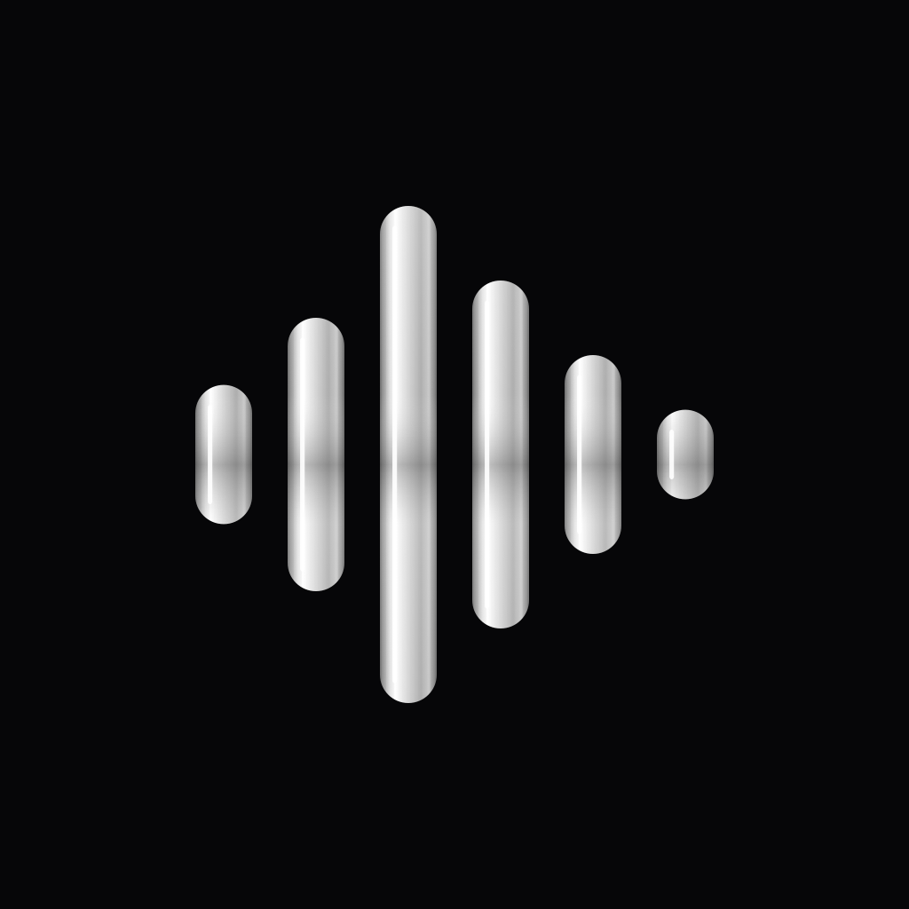
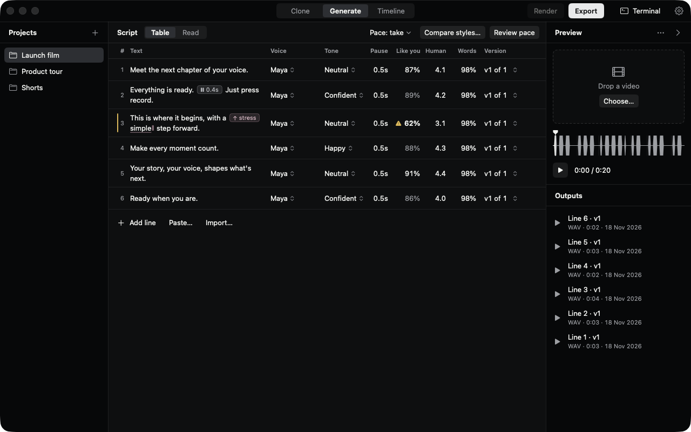
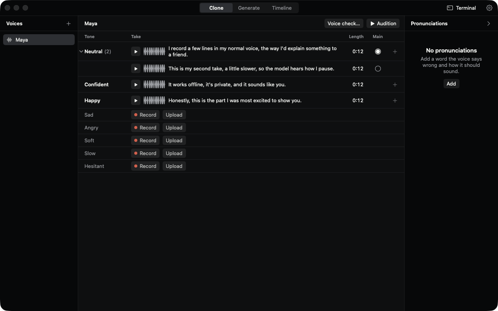
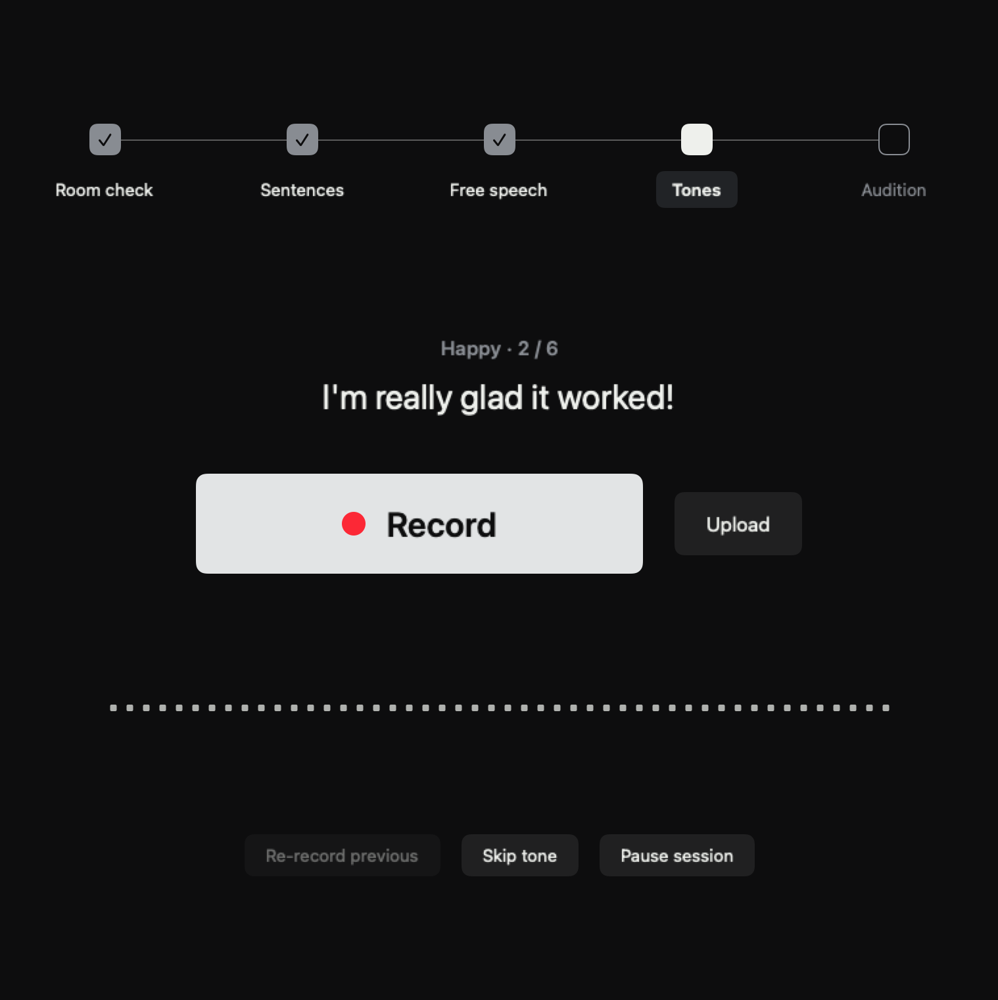

<p align="center"></p>

<h1 align="center">VocalCord</h1>

VocalCord clones your voice and turns scripts into voiceovers, rendering everything on your Mac.



## Features

- **Clone a voice** from one 10–20 second clip, a guided session of about 8 minutes, or any audio or video file. Long files are cut into clips, grouped by speaker.
- **Write a script** line by line, each with its own voice, tone and pause. Press Return and only that line renders again, then plays.
- **Direct each word:** select words and right-click (or type `[`) to add a pause, slow down or speed up a phrase, stress a word, or respell it for the voice. Pauses and speed apply instantly, without a new render. Tags such as `[confident]` set a tone mid-line.
- **Read along:** the script lights up word by word as it plays, in the table, in a large Read view (click a word to play from it) and under Timeline clips. A pace check flags rushed or dragging phrases against your own take's pace, with a one-click fix.
- **Score every line:** how much it sounds like you, how human it sounds, whether the words came out right, and whether its pitch, pace and pauses stay true to your take. A line that fails renders again, up to five times, and keeps its best version.
- **Voice check:** render ten test lines (every tone, one line ten times, or long lines) to see how a voice holds up, with the time it will take on your Mac shown first.
- **Edit on a timeline:** split, trim, move and space out your renders, and set each clip's volume, fades, speed, pitch, warmth and brightness, or remove noise. A line rendered again asks before replacing your cuts, and export follows the timeline.
- **Preview against your video**, then export WAV or M4A, with captions and per-line or per-voice files.
- **Terminal panel** (optional): Claude Code, Codex or OpenCode reads your script, word timings and pace, and proposes edits that you accept or reject. Review pace asks it to direct the rhythm for you.
- **Jev plugin** (optional): checks that each line reads as speech and fits its tone.
- **Keyboard first:** ⌘1, ⌘2 and ⌘3 switch between Clone, Generate and Timeline; ⌃` shows the Terminal, ⌥⌘0 the side panel, ⌘R renders and ⇧⌘E exports.





## Requirements

- A Mac with Apple silicon (M1 or later)
- macOS 26 or later
- About 8 GB of free disk space
- An internet connection for the first run

## Install

1. Download `VocalCord-1.2.0.dmg` from [Releases](../../releases) and drag VocalCord to Applications.
2. VocalCord is not signed by Apple, so macOS blocks the first launch. Right-click VocalCord in Applications and choose **Open**. Or try to open it once, then go to **System Settings → Privacy & Security** and click **Open Anyway**.
3. On first launch, VocalCord installs its voice engine and downloads the models, about 4.6 GB. This happens once.

## Privacy

Recording, cloning, rendering and scoring all run on your Mac. Voices and projects stay in `~/Library/Application Support/VocalCord`. Setup downloads Python and its packages from GitHub and PyPI, and the models from Hugging Face; it uploads nothing.

Two optional features use outside services:

- The terminal agents run with your own Claude Code, Codex or OpenCode sign-in, so what they read and write goes to that provider.
- The Jev plugin sends only script text to TypeSafe.

## Build from source

Needs Xcode 26. In a clone of this repo:

```sh
./build.sh                # VocalCord.app, in this folder
scripts/make-dmg.sh       # dist/VocalCord-1.2.0.dmg
swift test
```

With an `engine/.venv` next to it (see [engine/README.md](engine/README.md)), the built app uses that engine and skips first-run setup.

## License

The code is under the [PolyForm Noncommercial License 1.0.0](LICENSE.md): free for personal use, not for commercial use. It is not open source by the OSI definition.

The Breeze TTS 2 model and everything you make with it are under the [BreezeBlue Research and Non-Commercial License](https://huggingface.co/BreezeBlue/Breeze-TTS-2/blob/main/LICENSE): no commercial use, and no cloning a real person's voice without their consent. Other components and their licences are in [THIRD_PARTY_NOTICES.md](THIRD_PARTY_NOTICES.md).
